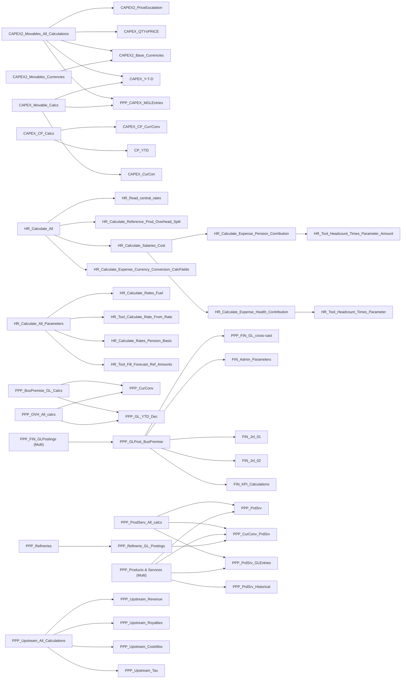

# Data actions

Exported 2026-11-09 from `My Files/Public/NNPC/NNPC - PPP`. 65 data actions. Generated by `tools/generate_docs.py` — do not edit by hand; edit SAC, re-export, regenerate.

## Call map

Multi-step chains (data action → embedded data actions).

## Index

| Data action | Description | Model | Steps | Called by | Stories | Last changed |
|---|---|---|---|---|---|---|
| [CAPEX FIN Posting](CAPEX_FIN_Posting.md) | CAPEX FIN Posting | PPP Financial | 2×crossmodelcopy | — | — | 2026-07-13 |
| [CAPEX2_Base_Currencies](CAPEX2_Base_Currencies.md) | PPP CAPEX - Base level currency conversions | CAPEX | 2×script, 1×conversion | CAPEX2_Movables_All_Calculations, CAPEX2_Movables_Currencies | — | 2026-10-07 |
| [CAPEX2_Movables_All_Calculations](CAPEX2_Movables_All_Calculations.md) | CAPEX2_Movables_All_Calculations | CAPEX | 5×nested_sequence | — | PPP_CAPEX | 2026-10-13 |
| [CAPEX2_Movables_Currencies](CAPEX2_Movables_Currencies.md) | CAPEX2_Movables_Currencies | CAPEX | 1×nested_sequence | — | — | 2026-08-06 |
| [CAPEX2_PriceEscalation](CAPEX2_PriceEscalation.md) | CAPEX2_PriceEscalation | CAPEX | 1×crossmodelcopy, 1×script | CAPEX2_Movables_All_Calculations | PPP_CAPEX | 2026-10-06 |
| [CAPEX_CP_Calcs](CAPEX_CP_Calcs.md) | CAPEX_CP_Calcs | CAPEX | 2×nested_sequence | — | — | 2026-08-06 |
| [CAPEX_CP_CurrConv](CAPEX_CP_CurrConv.md) | CP Currency Conversion | CAPEX | 1×conversion, 2×script, 1×delete_facts | CAPEX_CP_Calcs | PPP_CAPEX | 2026-10-07 |
| [CAPEX_CurCon](CAPEX_CurCon.md) | PPP Currency Conversion - CAPEX | CAPEX | 2×script, 1×conversion | CAPEX_Movable_Calcs | — | 2026-08-06 |
| [CAPEX_Movable_Calcs](CAPEX_Movable_Calcs.md) | CAPEX_Movable_Calcs | CAPEX | 3×nested_sequence | — | — | 2026-07-17 |
| [CAPEX_QTYxPRICE](CAPEX_QTYxPRICE.md) | CAPEX_QTYxPRICE | CAPEX | 2×script | CAPEX2_Movables_All_Calculations | — | 2026-10-07 |
| [CAPEX_Y-T-D](CAPEX_Y-T-D.md) | CAPEX_Y-T-D | CAPEX | 2×script | CAPEX2_Movables_All_Calculations, CAPEX_Movable_Calcs | — | 2026-08-24 |
| [CAPEX_YTD](CAPEX_YTD.md) | CAPEX_YTD | CAPEX | 2×script | — | — | 2026-07-06 |
| [CP_YTD](CP_YTD.md) | YTD Capital Projects | CAPEX | 2×script | CAPEX_CP_Calcs | PPP_CAPEX | 2026-08-26 |
| [FIN_Admin_Parameters](FIN_Admin_Parameters.md) | FIN - Copy Admin parameters from BusPremise | PPP Financial | 1×crossmodelcopy, 3×script | PPP_GLPost_BusPremise | — | 2026-10-08 |
| [FIN_Jnl_01](FIN_Jnl_01.md) | FIN Education tax | PPP Financial | 1×delete_facts, 2×script | PPP_GLPost_BusPremise | — | 2026-10-09 |
| [FIN_Jnl_02](FIN_Jnl_02.md) | FIN Taxation | PPP Financial | 2×delete_facts, 5×script, 1×conversion | PPP_GLPost_BusPremise | — | 2026-10-09 |
| [FIN_JV_PSC_Cr_reverse sign](FIN_JV_PSC_Cr_reverse_sign.md) | JV's and PSC's Posting - Cr reverse sign | PPP Financial | 1×script | — | — | 2026-07-26 |
| [FIN_KPI_Calculations](FIN_KPI_Calculations.md) | KPI Calculations | PPP Financial | 5×script | PPP_GLPost_BusPremise | PPP_Financial | 2026-10-08 |
| [HR_Calculate_All](HR_Calculate_All.md) | HR_Calculate_All | PPP Workforce planning | 4×nested_sequence | — | PPP_HR | 2026-10-14 |
| [HR_Calculate_All_Parameters](HR_Calculate_All_Parameters.md) | HR_Calculate_All_Parameters | PPP Workforce planning | 5×nested_sequence, 1×script | — | PPP_HR_Parameters | 2026-10-19 |
| [HR_Calculate_Expense_Currency_Conversion_CalcFields](HR_Calculate_Expense_Currency_Conversion_CalcFields.md) |  | PPP Workforce planning | 1×conversion, 1×copy, 1×delete_facts | HR_Calculate_All | PPP_HR | 2026-08-13 |
| [HR_Calculate_Expense_Currency_Conversion_Manual_Input](HR_Calculate_Expense_Currency_Conversion_Manual_Input.md) |  | PPP Workforce planning | 1×conversion, 1×script | — | PPP_HR | 2026-07-29 |
| [HR_Calculate_Expense_Health_Contribution](HR_Calculate_Expense_Health_Contribution.md) | HR Health Contribution Expense | PPP Workforce planning | 2×nested_sequence | HR_Calculate_Salaries_Cost | PPP_HR | 2026-08-13 |
| [HR_Calculate_Expense_Pension_Conribution](HR_Calculate_Expense_Pension_Conribution.md) | HR Pension Contribution Calculation | PPP Workforce planning | 1×nested_sequence | HR_Calculate_Salaries_Cost | PPP_HR | 2026-08-14 |
| [HR_Calculate_Rates_Fuel](HR_Calculate_Rates_Fuel.md) |  | PPP Workforce planning | 2×script | HR_Calculate_All_Parameters | PPP_HR, PPP_HR_Parameters | 2026-10-19 |
| [HR_Calculate_Rates_Pension_Basis](HR_Calculate_Rates_Pension_Basis.md) | HR Pension Basis Calc | PPP Workforce planning | 2×script | HR_Calculate_All_Parameters | PPP_HR, PPP_HR_Parameters | 2026-08-14 |
| [HR_Calculate_Reference_Prod_Overhead_Split](HR_Calculate_Reference_Prod_Overhead_Split.md) | HR - Production/Overhead Split | PPP Workforce planning | 1×delete_facts, 4×script | HR_Calculate_All | PPP_HR | 2026-10-19 |
| [HR_Calculate_Salaries_Cost](HR_Calculate_Salaries_Cost.md) |  | PPP Workforce planning | 7×script, 1×allocation, 1×copy, 2×nested_sequence | HR_Calculate_All | PPP_HR | 2026-10-19 |
| [HR_Change_Lock_Status](HR_Change_Lock_Status.md) | HR - Change Lock Status | PPP Workforce planning | 1×copy, 1×delete_facts | — | — | 2026-07-25 |
| [HR_IntegrationTo_BusPremise](HR_IntegrationTo_BusPremise.md) | HR Integration to BusPremise | Business premise | 2×delete_facts, 1×crossmodelcopy, 1×script | — | PPP_Overheads | 2026-10-06 |
| [HR_Pension_contribution](HR_Pension_contribution.md) | HR_Pension_contribution | PPP Workforce planning | 2×script | — | — | 2026-08-14 |
| [HR_Read_central_rates](HR_Read_central_rates.md) | HR_Read_central_rates | PPP Workforce planning | 1×copy | HR_Calculate_All | PPP_HR | 2026-08-12 |
| [HR_Tool_Calculate_Rate_From_Rate](HR_Tool_Calculate_Rate_From_Rate.md) |  | PPP Workforce planning | 1×script | HR_Calculate_All_Parameters | PPP_HR, PPP_HR_Parameters | 2026-10-12 |
| [HR_Tool_Fill_Forecast_Ref_Amounts](HR_Tool_Fill_Forecast_Ref_Amounts.md) |  | PPP Workforce planning | 2×script | HR_Calculate_All_Parameters | PPP_HR, PPP_HR_Parameters | 2026-10-19 |
| [HR_Tool_Headcount_Times_Parameter](HR_Tool_Headcount_Times_Parameter.md) |  | PPP Workforce planning | 2×script | HR_Calculate_Expense_Health_Contribution | — | 2026-08-13 |
| [HR_Tool_Headcount_Times_Parameter_Amount](HR_Tool_Headcount_Times_Parameter_Amount.md) |  | PPP Workforce planning | 4×script | HR_Calculate_Expense_Pension_Conribution | — | 2026-10-13 |
| [PPP_BusPremise_GL_Calcs](PPP_BusPremise_GL_Calcs.md) | PPP_BusPremise_GL_Calcs | Business premise | 2×nested_sequence | — | — | 2026-07-22 |
| [PPP_BusPremise_YTD](PPP_BusPremise_YTD.md) | PPP_BusPremise_YTD | Business premise | 1×delete_facts, 1×script | — | PPP_BusPremise | 2026-08-24 |
| [PPP_CAPEX_MGLEntries](PPP_CAPEX_MGLEntries.md) | Movables GL Entries | CAPEX | 2×script | CAPEX2_Movables_All_Calculations, CAPEX_Movable_Calcs | — | 2026-10-07 |
| [PPP_Copy_PCycle_BusPremise](PPP_Copy_PCycle_BusPremise.md) | PPP Copy PCycle - Business Premise model | Business premise | 1×copy | — | PPP_Admin | 2026-08-04 |
| [PPP_Copy_PCycle_CAPEX](PPP_Copy_PCycle_CAPEX.md) | PPP Copy PCycle - CAPEX model | CAPEX | 1×copy | — | PPP_Admin | 2026-08-04 |
| [PPP_Copy_PCycle_HR](PPP_Copy_PCycle_HR.md) | PPP Copy PCycle - HR model | PPP Workforce planning | 1×copy | — | PPP_Admin | 2026-08-04 |
| [PPP_CurConv](PPP_CurConv.md) | PPP Currency conversion | Business premise | 1×delete_facts, 1×conversion | PPP_BusPremise_GL_Calcs, PPP_OVH_All_calcs | PPP_Overheads, PPP_ProdServices_bkup | 2026-10-13 |
| [PPP_CurConv_PrdSrv](PPP_CurConv_PrdSrv.md) | PPP Currency conversion - Products and Services | Business premise | 1×conversion | PPP_ProdServ_All_calcs, PPP_Products & Services (Multi), PPP_Refinerie_GL_Postings | PPP_ProdServices_bkup | 2026-08-11 |
| [PPP_FIN_GL_cross-cast](PPP_FIN_GL_cross-cast.md) | Financial model GL cross-cast | PPP Financial | 11×script | PPP_GLPost_BusPremise | PPP_Financial, PPP_Financial_Test | 2026-10-15 |
| [PPP_FIN_GLPostings (Multi)](PPP_FIN_GLPostings_Multi.md) | PPP_FIN_GLPostings (Multi) | Business premise | 1×nested_sequence | — | — | 2026-07-22 |
| [PPP_FIN_Reporting_Statistics](PPP_FIN_Reporting_Statistics.md) |  | PPP Financial | 1×crossmodelcopy, 1×script, 1×conversion | — | PPP_Financial_Test | 2026-08-11 |
| [PPP_GL_YTD_Dec](PPP_GL_YTD_Dec.md) | GL_YTD_Dec | Business premise | 2×script | PPP_BusPremise_GL_Calcs, PPP_OVH_All_calcs | PPP_Overheads, PPP_ProdServices_bkup | 2026-09-02 |
| [PPP_GLPost_BusPremise](PPP_GLPost_BusPremise.md) | GLPostings from BusPremise | PPP Financial | 2×script, 16×crossmodelcopy, 6×nested_sequence | PPP_FIN_GLPostings (Multi) | PPP_Financial, PPP_Financial_Test | 2026-10-09 |
| [PPP_OVH_All_calcs](PPP_OVH_All_calcs.md) | Overheads & other - All calculations | Business premise | 2×nested_sequence | — | PPP_Overheads | 2026-09-02 |
| [PPP_PrdSrv](PPP_PrdSrv.md) | Products and Services | Business premise | 1×script | PPP_ProdServ_All_calcs, PPP_Products & Services (Multi) | PPP_ProdServices_bkup | 2026-09-01 |
| [PPP_PrdSrv_BusServ](PPP_PrdSrv_BusServ.md) | Products & Services - Business services calcs | Business premise | 2×script, 1×conversion | — | PPP_ProdServices_bkup | 2026-08-26 |
| [PPP_PrdSrv_GLEntries](PPP_PrdSrv_GLEntries.md) | Product & Services GL entries | Business premise | 2×script | PPP_ProdServ_All_calcs, PPP_Products & Services (Multi) | PPP_ProdServices_bkup | 2026-09-01 |
| [PPP_PrdSrv_Historical](PPP_PrdSrv_Historical.md) | Products and Services - Historical calcs | Business premise | 3×script | PPP_Products & Services (Multi) | PPP_ProdServices, PPP_ProdServices_bkup, PPP_Refinerie | 2026-08-26 |
| [PPP_ProdServ_All_calcs](PPP_ProdServ_All_calcs.md) | PPP_ProdServ_All_calcs | Business premise | 3×nested_sequence | — | PPP_ProdServices | 2026-09-01 |
| [PPP_Products & Services (Multi)](PPP_Products_Services_Multi.md) | Products & Services (Multi) | Business premise | 4×nested_sequence | — | PPP_ProdServices, PPP_ProdServices_bkup | 2026-06-26 |
| [PPP_Refinerie_GL_Postings](PPP_Refinerie_GL_Postings.md) | PPP_Refinerie_GL_Postings | Business premise | 1×nested_sequence, 2×script | PPP_Refineries | PPP_Refinerie | 2026-08-26 |
| [PPP_Refineries](PPP_Refineries.md) | PPP_Refineries | Business premise | 8×script, 1×nested_sequence | — | PPP_ProdServices_bkup, PPP_Refinerie | 2026-08-26 |
| [PPP_Upstream](PPP_Upstream.md) | PPP Upstream | Business premise | 54×script, 1×crossmodelcopy | — | PPP_BusPremise_bkup | 2026-08-01 |
| [PPP_Upstream_All_Calculations](PPP_Upstream_All_Calculations.md) | PPP_Upstream_All_Calculations | Business premise | 4×nested_sequence | — | PPP_UStream | 2026-09-25 |
| [PPP_Upstream_CostAlloc](PPP_Upstream_CostAlloc.md) | PPP_Upstream_CostAlloc | Business premise | 12×script, 1×crossmodelcopy | PPP_Upstream_All_Calculations | PPP_UStream | 2026-11-10 |
| [PPP_Upstream_old](PPP_Upstream_old.md) | PPP Upstream (old) | Business premise | 2×script | — | — | 2026-08-01 |
| [PPP_Upstream_Revenue](PPP_Upstream_Revenue.md) | PPP Upstream_Revenue | Business premise | 8×script | PPP_Upstream_All_Calculations | PPP_UStream | 2026-11-10 |
| [PPP_Upstream_Royalties](PPP_Upstream_Royalties.md) | PPP Upstream - Royalties | Business premise | 22×script | PPP_Upstream_All_Calculations | PPP_UStream | 2026-11-10 |
| [PPP_Upstream_Tax](PPP_Upstream_Tax.md) | PPP Upstream - Taxation | Business premise | 21×script | PPP_Upstream_All_Calculations | PPP_UStream | 2026-11-10 |

## Not referenced

Not called by another data action and not found in any story in this folder (may still be used from elsewhere, e.g. a calendar task):

- [CAPEX FIN Posting](CAPEX_FIN_Posting.md)
- [CAPEX2_Movables_Currencies](CAPEX2_Movables_Currencies.md)
- [CAPEX_CP_Calcs](CAPEX_CP_Calcs.md)
- [CAPEX_Movable_Calcs](CAPEX_Movable_Calcs.md)
- [CAPEX_YTD](CAPEX_YTD.md)
- [FIN_JV_PSC_Cr_reverse sign](FIN_JV_PSC_Cr_reverse_sign.md)
- [HR_Change_Lock_Status](HR_Change_Lock_Status.md)
- [HR_Pension_contribution](HR_Pension_contribution.md)
- [PPP_BusPremise_GL_Calcs](PPP_BusPremise_GL_Calcs.md)
- [PPP_FIN_GLPostings (Multi)](PPP_FIN_GLPostings_Multi.md)
- [PPP_Upstream_old](PPP_Upstream_old.md)
